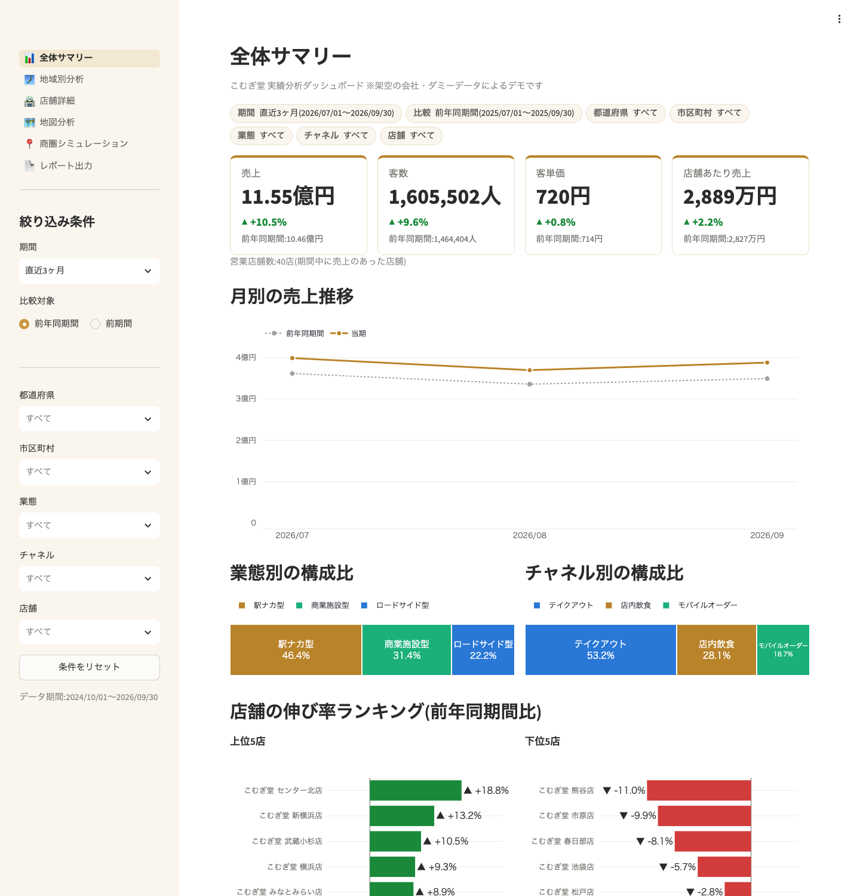
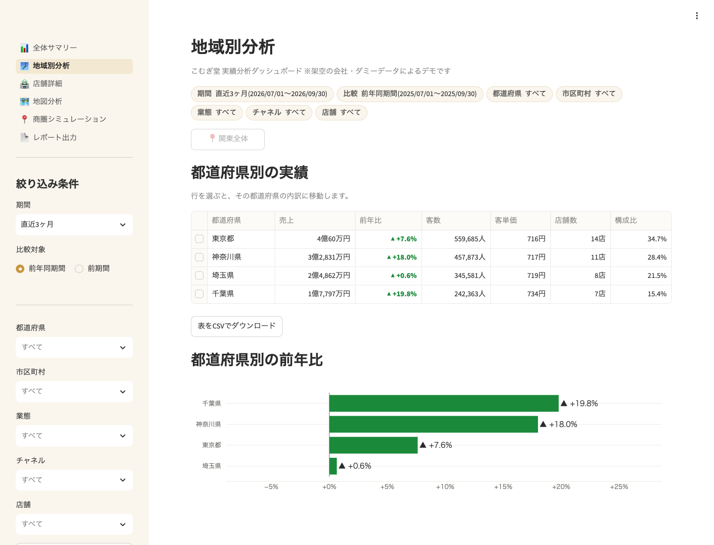
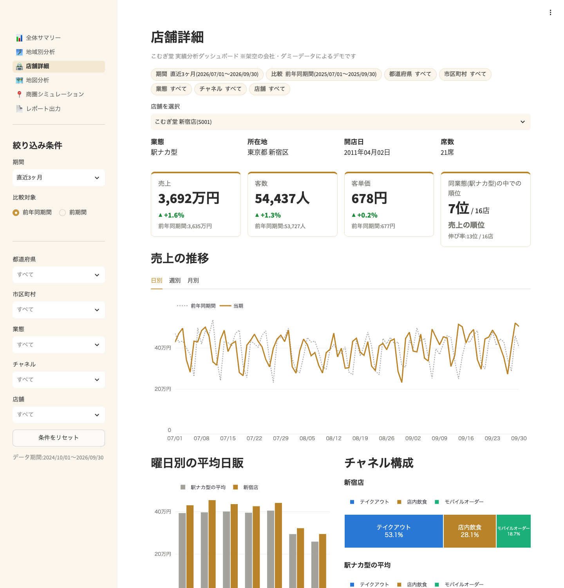
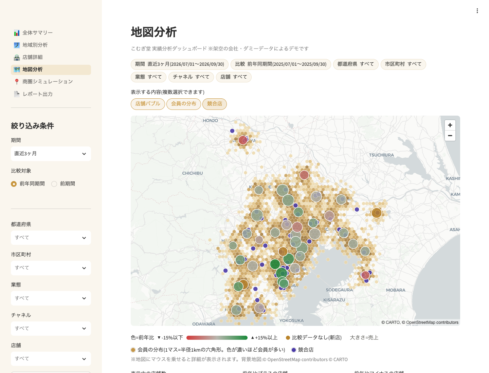
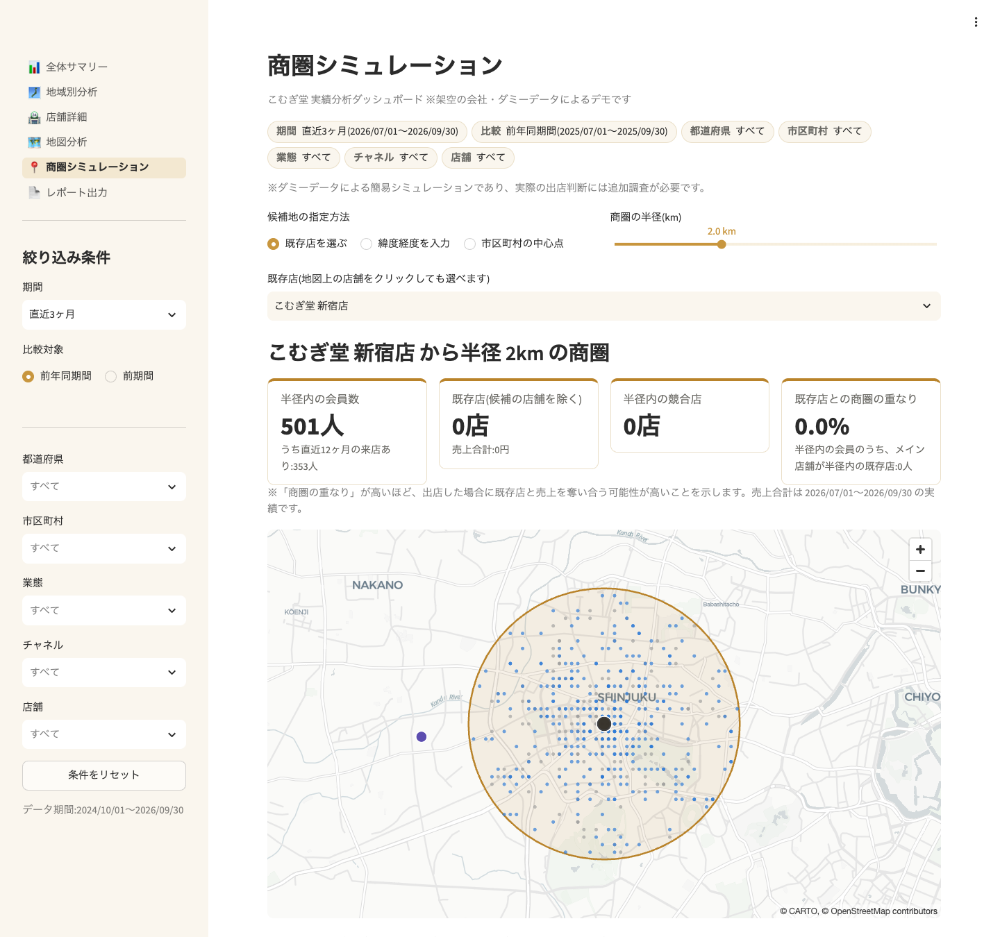
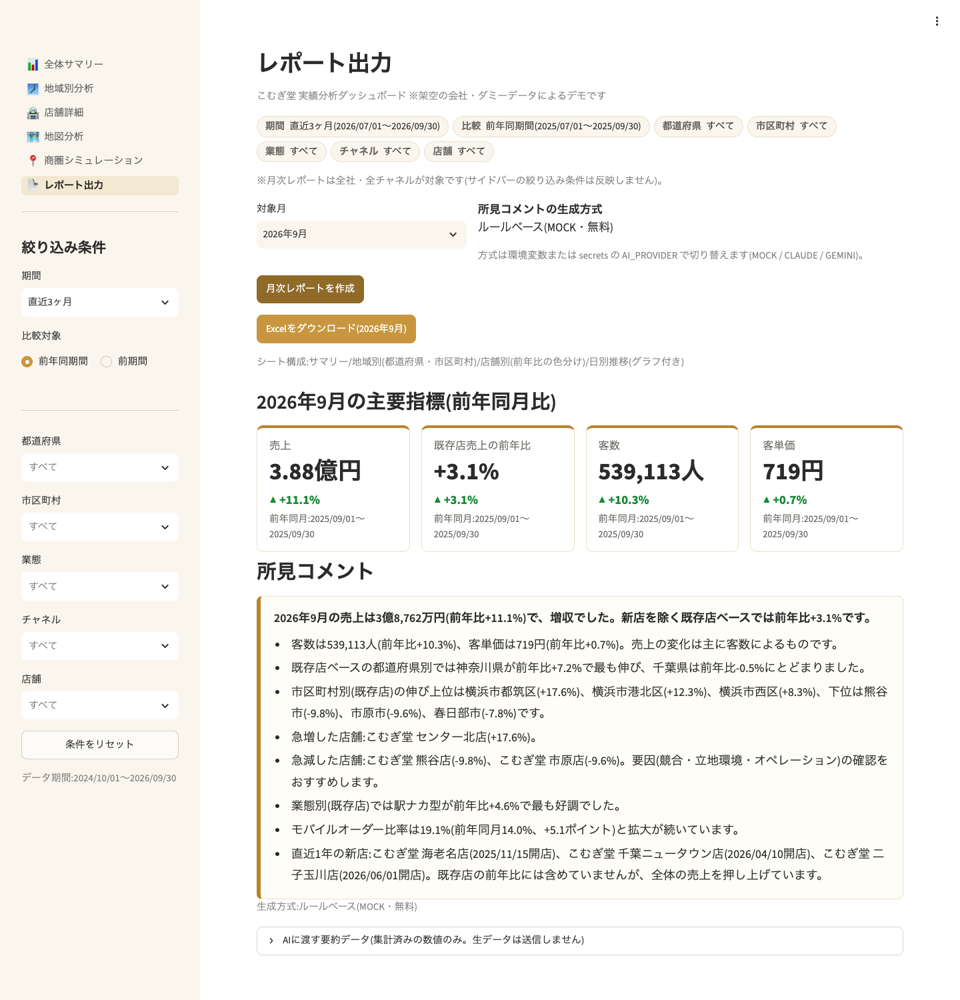

# 多店舗チェーン向け 実績分析ダッシュボード(デモ)

架空のベーカリーカフェチェーン「こむぎ堂ホールディングス株式会社」(関東40店舗)を題材にした、
店舗実績の分析ダッシュボードです。Streamlit + DuckDB で作成しています。

> **このリポジトリのデータはすべて架空のダミーデータです。** 実在の企業・店舗・人物とは関係ありません。
> 店名の「〇〇店」には実在の駅名・地名を使っていますが、位置と実績はすべて架空です。

- **デモ:** https://komugido-dashboard.streamlit.app/
- **画面:** 全体サマリー / 地域別分析 / 店舗詳細 / 地図分析 / 商圏シミュレーション / レポート出力



---

## このツールで解決すること

### 課題
- 店舗ごとの売上データはあるが、エリア別・業態別に見るには毎回Excelで集計し直している
- 経営会議の資料づくりに、担当者が毎月**丸2日**かけている
- 「どの地域が伸びていて、どこが落ちているか」が直感的に分からない
- 新規出店を検討するとき、候補地の周辺にどれだけ会員や既存店があるかをすぐに出せない

### 解決
- 店舗・市区町村・都道府県・業態の各単位で、売上や客数を**瞬時に集計**(条件変更から約0.1秒で再表示)
- 地図上でエリアごとの実績を**色と大きさで可視化**
- 出店候補地の**商圏シミュレーション**(半径内の会員数・既存店・競合・商圏の重なり)
- 月次レポートを**ボタン1つでExcel出力**(所見コメントも自動生成)

### 効果
- 毎月丸2日かかっていた集計・資料作成が**ボタン1つ**に
- 会議の場で、**その場で条件を変えて深掘り**できる
- 出店判断の材料を**数分で用意**できる

---

## 機能一覧

| 画面 | 主な機能 |
|---|---|
| 全体サマリー | 売上・客数・客単価・店舗あたり売上の指標カード(比較期間との増減率)、月別推移(当期と比較期間を重ねて表示)、業態別・チャネル別の構成比、伸び率ランキング(上位5店・下位5店) |
| 地域別分析 | 都道府県 → 市区町村 → 店舗のドリルダウン表とパンくずリスト、地域別の前年比グラフ、CSVダウンロード |
| 店舗詳細 | 基本情報、日別・週別・月別の推移、曜日別の平均日販、チャネル構成、同業態の平均との比較、同業態の中での順位 |
| 地図分析 | 店舗バブル(大きさ=売上、色=前年比)、会員の分布(六角形で集計)、競合店の表示切り替え、マウスを乗せると詳細を表示 |
| 商圏シミュレーション | 候補地の指定(地図上の既存店/緯度経度/市区町村の中心点)、半径0.5〜5km、半径内の会員・既存店・競合・商圏の重なり、半径ごとの比較表 |
| レポート出力 | 月次レポート(Excel・4シート)の作成とダウンロード、所見コメントのプレビュー |

共通のサイドバーで、期間(今月/先月/直近3ヶ月/今年/昨年/カスタム)・比較対象(前年同期間/前期間)・
都道府県・市区町村・業態・チャネル・店舗を絞り込めます。条件はページを移動しても保持されます。

### 画面

| 地域別分析 | 店舗詳細 |
|---|---|
|  |  |

| 地図分析 | 商圏シミュレーション |
|---|---|
|  |  |

| レポート出力 | (動画のサムネイルなどを置く場所) |
|---|---|
|  | |

### 月次レポート(Excel)の構成
1. **サマリー**:主要指標(前年同月比・前月比・既存店ベース)、業態別、チャネル別、所見コメント
2. **地域別**:都道府県・市区町村別の実績(都道府県ごとの小計、全店/既存店の前年比)
3. **店舗別**:店舗ごとの実績(前年比を条件付き書式で赤〜緑に色分け)
4. **日別推移**:日別の売上・客数と前年同日・前年同曜日の比較、折れ線グラフ

サンプル:[`data/sample_monthly_report_202609.xlsx`](data/sample_monthly_report_202609.xlsx)

### 所見コメントの生成方式

| `AI_PROVIDER` | 内容 |
|---|---|
| `MOCK`(初期値) | APIを使わず、前年比の上位・下位、急増・急減などのルールから文章を作成。無料で完全に動作 |
| `CLAUDE` | Anthropic API(Claude)で作成 |
| `GEMINI` | Google Gemini API で作成 |

- AIには**集計済みの数値(要約データ)だけ**を渡し、生データ(日次・会員)は送りません。
- API呼び出しに失敗した場合は自動で `MOCK` に切り替え、画面とExcelに注記を表示します。

---

## 技術構成

- Python 3.12 / Streamlit(マルチページ)
- pandas / numpy / DuckDB(Parquet をメモリ上に読み込んで高速集計)
- Plotly(グラフ)/ pydeck(地図。背景は CARTO の無料ベースマップで、APIキー不要)
- openpyxl(Excel レポート)/ pytest(テスト)
- anthropic / google-genai(所見コメントの CLAUDE / GEMINI モード用。MOCK では不使用)

```
demo3-store-analytics/
├── app.py                     # トップページ(全体サマリー)とページ一覧
├── app_pages/                 # 各ページ(地域別分析〜レポート出力)
├── src/
│   ├── config.py              # 定数・色・書式
│   ├── data_loader.py         # データ読み込み(キャッシュ付き)
│   ├── queries.py             # DuckDB による集計
│   ├── filters.py             # 共通フィルター
│   ├── geo.py                 # 距離計算・半径検索・六角形集計
│   ├── charts.py / maps.py    # グラフ・地図の部品
│   ├── report.py              # Excel レポート
│   └── ai_comment.py          # 所見コメント(MOCK/CLAUDE/GEMINI)
├── scripts/
│   ├── generate_dummy_data.py # ダミーデータ生成(シード固定)
│   └── make_sample_report.py  # サンプルレポート出力
├── data/                      # ダミーデータ(Parquet)とサンプルレポート
├── docs/screenshots/          # README 用の画面
└── tests/                     # pytest
```

> ページのフォルダ名を `pages/` ではなく `app_pages/` にしているのは、`st.navigation`(日本語のメニュー名)と
> Streamlit の `pages/` 自動読み込みが競合するためです。

---

## ローカルでの起動手順

### 1. 仮想環境の作成とインストール

**uv を使う場合(おすすめ)**
```bash
cd demo3-store-analytics
uv venv --python 3.12
source .venv/bin/activate        # Windows: .venv\Scripts\activate
uv pip install -r requirements.txt
```

**venv を使う場合**(Python 3.11 以上が必要)
```bash
cd demo3-store-analytics
python3 -m venv .venv
source .venv/bin/activate
pip install -r requirements.txt
```

### 2. 起動
```bash
streamlit run app.py
```
ブラウザで http://localhost:8501 が開きます。ダミーデータは `data/` に同梱済みです。

### 3. (任意)AI による所見コメント
`.streamlit/secrets.toml.example` をコピーして `.streamlit/secrets.toml` を作成し、
`AI_PROVIDER` と API キーを設定してから起動し直します(環境変数でも設定できます)。
`secrets.toml` は `.gitignore` 済みなので、コミットされません。

### その他のコマンド
```bash
pytest -q                                  # テスト(集計・距離計算・レポート・全ページのスモークテスト)
python scripts/generate_dummy_data.py      # ダミーデータの再生成(何度実行しても同じ内容)
python scripts/make_sample_report.py       # サンプルレポートを data/ に出力
```

---

## 公開(Streamlit Community Cloud)

1. GitHub に公開リポジトリを作成し、このフォルダをプッシュします(`.streamlit/secrets.toml` は含まれません)。
2. https://share.streamlit.io にGitHubアカウントでログインし、「Create app」→ リポジトリ・ブランチを選び、
   Main file path に `app.py` を指定します。
3. 「Advanced settings」で Python のバージョンを **3.12** にします。
   AIモードを使う場合は、同じ画面の「Secrets」に `secrets.toml` と同じ形式でキーを貼り付けます(使わなければ不要)。
4. 「Deploy」を押すと数分で公開されます(このリポジトリの公開先:https://komugido-dashboard.streamlit.app/)。

---

## 操作動画の台本(約2分)

| 時間 | 画面 | 操作 | ナレーション |
|---|---|---|---|
| 0:00〜0:15 | 全体サマリー | 画面全体を見せる | 「関東40店舗のベーカリーカフェチェーンを想定した実績ダッシュボードです。毎月2日かかっていた集計を、開いた瞬間に確認できます。」 |
| 0:15〜0:30 | 全体サマリー | 期間を「今年」→「直近3ヶ月」、業態を「駅ナカ型」に切り替える | 「期間や業態を変えると、指標とグラフがすぐに切り替わります。伸びている店・落ちている店もランキングで一目で分かります。」 |
| 0:30〜0:55 | 地域別分析 | 神奈川県 → 横浜市港北区 とドリルダウン、パンくずで戻る、CSVボタンを見せる | 「地域別では、都道府県から市区町村、店舗まで掘り下げられます。神奈川の横浜エリアが好調だと分かります。表はCSVで持ち出せます。」 |
| 0:55〜1:15 | 地図分析 | 店舗バブルにマウスを乗せる → 会員の分布・競合店を重ねる | 「地図では、バブルの大きさが売上、色が前年比です。会員の分布や競合店を重ねて、エリアの状況を直感的に把握できます。」 |
| 1:15〜1:40 | 商圏シミュレーション | 既存店を選び、半径スライダーを1km→3kmに動かす → 比較表を見せる | 「出店候補地を選ぶと、半径内の会員数、既存店、競合店、既存店との商圏の重なりがすぐに出ます。半径ごとの比較表で、出店判断の材料を数分で用意できます。」 |
| 1:40〜2:00 | レポート出力 | 「月次レポートを作成」→ 所見コメントを見せる → Excelを開く | 「最後に、月次レポートはボタン1つでExcelに出力できます。所見コメントも自動で作成されるので、そのまま会議資料として使えます。」 |

---

## クラウドソーシングの提案文で使える紹介文

> 多店舗チェーン向けの実績分析ダッシュボードを、Python(Streamlit)で構築したデモです。
> 店舗・地域・業態別の集計、地図での可視化、出店候補地の商圏シミュレーション、月次レポートのExcel自動出力に対応しています。
> 「毎月の集計・資料作成に何日もかかっている」「会議でその場で深掘りしたい」といった課題を、既存の売上データを活かして解決します。

---

## 注意事項

- データはすべて `scripts/generate_dummy_data.py` で作成した**架空のダミーデータ**です。
  会員の位置は居住地の目安として約100m単位に丸めています。
- 商圏シミュレーションは**ダミーデータによる簡易シミュレーション**であり、実際の出店判断には追加調査が必要です。
- 背景地図:© OpenStreetMap contributors © CARTO(CARTO のベースマップ利用条件に従ってください)。
- CLAUDE / GEMINI モードは各社の API 利用規約・料金に従います(Anthropic API は従量課金、Gemini API は無料枠あり)。
